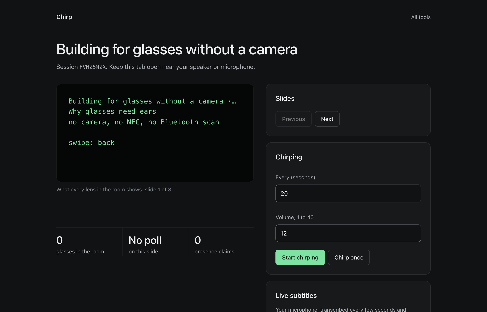
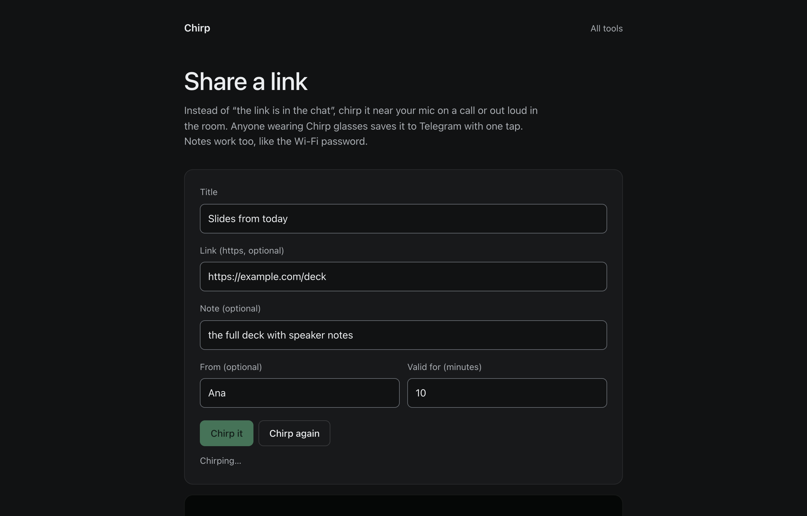
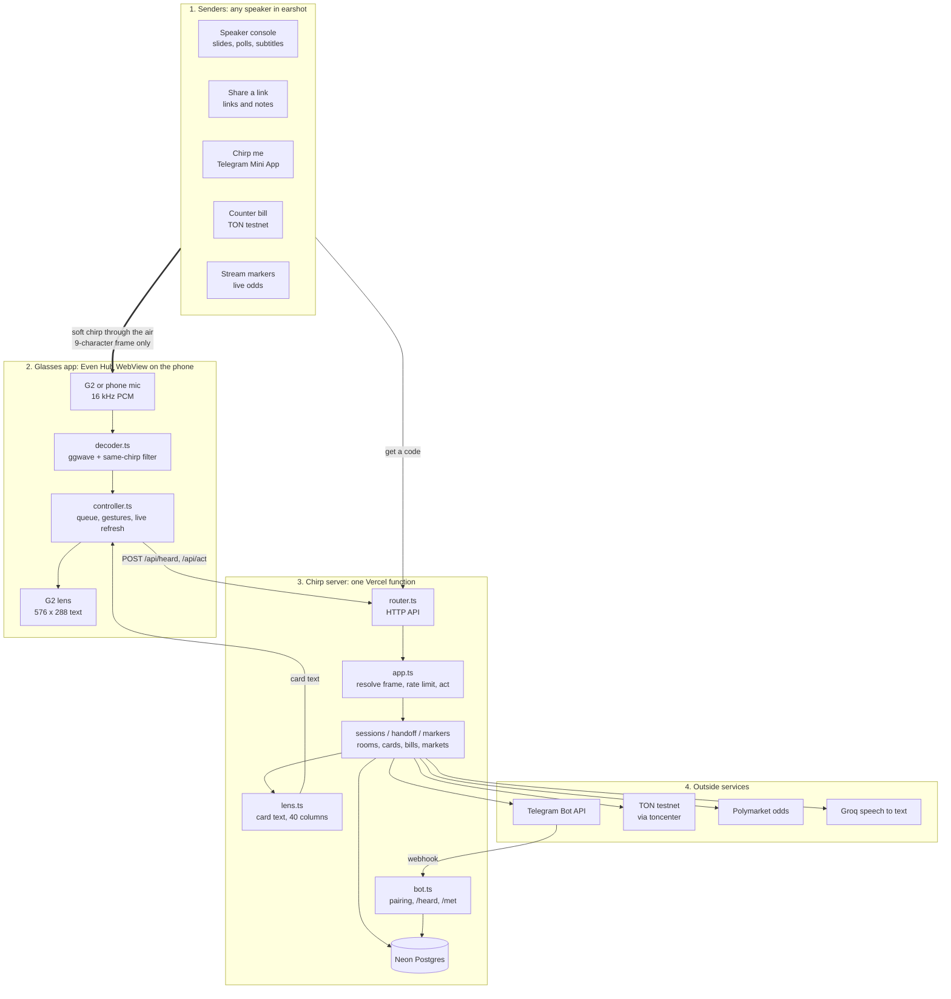
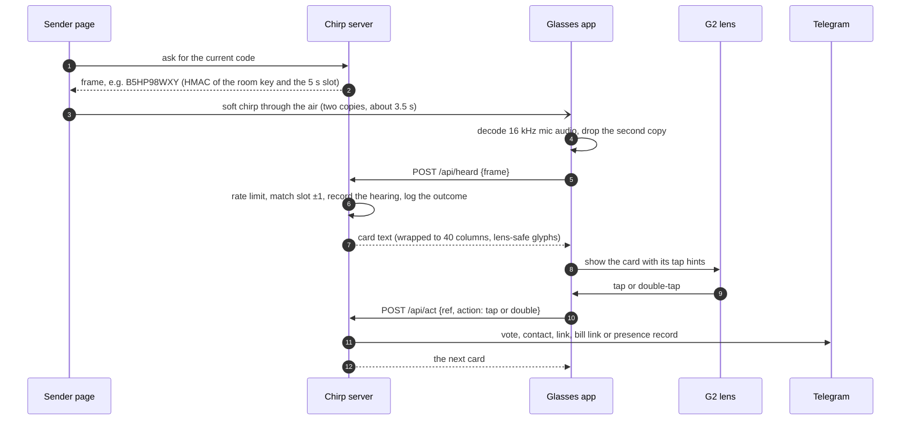
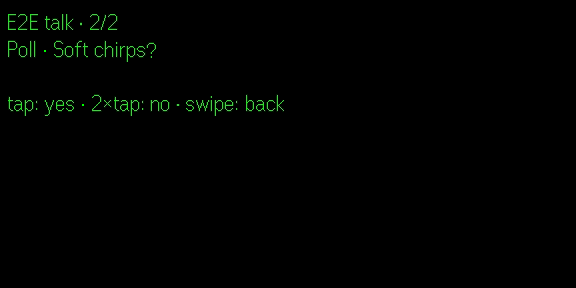

<div align="center">


# CHIRP

### Any speaker can talk to your glasses.

[](https://github.com/subheeksh5599/chirp/actions/workflows/ci.yml)

[](https://chirp-liart-six-38.vercel.app)
[](LICENSE)


**[ Watch the demo ▶ ](https://youtu.be/qwdeAFHoWMI)** · **[ For judges ↓ ](#for-judges-and-reviewers)** · **[ See it in one command ↓ ](#-see-it-in-one-command)** · **[ Measurements ↓ ](#what-the-sound-measurements-say)** · **[ Status table ↓ ](#whats-real-the-status-table)** · **[ Architecture ↓ ](#architecture)**

</div>

<p align="center"><a href="https://youtu.be/qwdeAFHoWMI"></a><br><sub>▶ <a href="https://youtu.be/qwdeAFHoWMI">Watch the 1-minute demo</a> (simulator and phone, recorded live)</sub></p>

"Scan the QR before I change the slide." Half the room misses it, the back rows can't reach it, and glasses can't scan at all: they have no camera, no NFC, and apps get no Bluetooth scanning.

**Chirp makes the microphone the glasses' way to receive from the world.** A speaker's laptop, a phone, a PA system or a stream plays a short, soft chirp that carries a 9-character code. Every pair of glasses in earshot hears it, the server turns the code into a card, and the lens shows it. One tap acts on it, and the result lands in Telegram. **One sender, a whole room of listeners, and nobody in the audience does anything but look.**

Chirp targets **Even Realities G2** glasses. Their apps are web pages that run inside the Even Hub app on the paired phone; `.ehpk` is that platform's app package.

> **Verified so far:** everything runs against production services, and the glasses app runs in the official Even Hub simulator, which hears the room through the laptop mic. A phone chirping a shared link into the simulator opened the link card (simulator log: `heard HJ6YH7G4Y`, `card link Test link`). A phone as the sender: 10 of 10 at 30 cm. Not tested yet: real G2 glasses, a phone at 3–5 m, a live call or live stream, and a locked phone. The [status table](#whats-real-the-status-table) says which line is which.

```
SOUND CARRIES A CODE  ≠  THE CODE CARRIES CONTENT  ≠  HEARING ONCE PROVES YOU WERE THERE
```

The sound only carries a short code. The content lives on the server. And presence is a rule over many rotating codes, not one. By default it takes at least **3 different room codes heard across at least 10 minutes** (the speaker can change both), so a single code recorded and posted to a group chat never qualifies.

A **frame** is the 9 characters one chirp carries. A **slot** is a 5-second window; a room's code changes every slot. The sound codec is [ggwave](https://github.com/ggerganov/ggwave).

## Live status

| Surface | Status | The evidence |
|---|---|---|
| API | ✅ live | `GET /api/health` on [chirp-liart-six-38.vercel.app](https://chirp-liart-six-38.vercel.app/api/health), output [below](#-see-it-in-one-command) |
| Sender tools (console, link, bill, markers, Mini App) | ✅ live | [chirp-liart-six-38.vercel.app](https://chirp-liart-six-38.vercel.app); the console and link screenshots above are from production |
| Telegram bot | ✅ webhook set | message [@Chirp567_bot](https://t.me/Chirp567_bot); `GET /api/config` returns its name from its own token |
| Glasses app | ✅ runs in the simulator, packs to `.ehpk` | `npm run e2e:room` (5/5 checks), `npm run pack -w @chirp/glasses` |
| Sound through the air | ✅ simulator: Mac speaker → Mac mic, and a phone at 30 cm (10/10) and 1 m | [docs/MEASUREMENTS.md](docs/MEASUREMENTS.md) |
| Real glasses | ⏳ not tested | no device yet; tested in the official Even Hub simulator, and the phone-mic fallback is built in |
| Tests | ✅ 148 passing in CI; a fresh clone passes with nothing configured (141 pass, 7 need secrets and skip) | [GitHub Actions](https://github.com/subheeksh5599/chirp/actions) |

## The 20-second pitch

**One laptop talks to every pair of glasses in the room.** A speaker's console plays a soft chirp every 20 seconds. Every lens in earshot follows the current slide, votes in live polls with a tap, and reads live subtitles. Only the speaker sets anything up; the audience just looks. A QR code can't do this: it reaches the front rows for a few seconds, and glasses can't scan it at all.

The same chirp then does more:

- **Presence.** The room's code changes every 5 seconds. Hearing at least 3 of them across 10 minutes (the defaults) earns a signed presence record you can anchor on TON testnet.
- **Markets.** A stream host marks the market they're talking about. Viewers' lenses show it with live odds, and a double-tap opens a paper position.
- **Hand-off.** A host chirps a link on a voice call. A counter chirps a bill. Someone you meet chirps their card from Telegram, and one tap connects you. The lens then suggests a follow-up message (tap to send, double-tap for the next), or you hold and say your own.

Every one of those ends in your Telegram chat with the bot, and `/heard` keeps the day's list.

**What the sound gives away:** only a short code, never your name or number. A contact card or bill works for the first tap only and dies after 60 seconds anyway, so a recorded chirp is useless. A link stays open to everyone who heard it, and one recorded room code can never prove you were there.

| The speaker console | Sharing a link |
|---|---|
|  |  |

The console, link, bill and Mini App pages show the lens text the server will send, rendered by the same function, so the preview can't drift from what wearers see.

## Table of contents

- [Live status](#live-status)
- [The 20-second pitch](#the-20-second-pitch)
- [For judges and reviewers](#for-judges-and-reviewers)
- [See it in one command](#-see-it-in-one-command)
- [What Chirp is NOT](#what-chirp-is-not)
- [The problem](#the-problem)
- [Why it's useful every day](#why-its-useful-every-day)
- [What I built](#what-i-built)
- [Architecture](#architecture)
- [The chirp, step by step](#the-chirp-step-by-step)
- [Where each guarantee is enforced](#where-each-guarantee-is-enforced)
- [What the sound measurements say](#what-the-sound-measurements-say)
- [On the lens](#on-the-lens)
- [Engineering decisions and the traps that taught me something](#engineering-decisions-and-the-traps-that-taught-me-something)
- [What's real: the status table](#whats-real-the-status-table)
- [Definition of done](#definition-of-done)
- [Attack → test](#attack--test)
- [Limitations](#limitations)
- [Security and privacy](#security-and-privacy)
- [Tech stack](#tech-stack)
- [Project layout](#project-layout)
- [Run it yourself](#run-it-yourself)
- [Tests](#tests)
- [Built on](#built-on)
- [License](#license)

## For judges and reviewers

No G2 glasses needed, and no clone. Everything below runs against the live deployment.

**Two minutes, nothing to install: check the real runs**

| What | Open | You should see |
|---|---|---|
| A presence record, earned through the air and anchored on TON testnet | [`/api/presence/27VHDCYT`](https://chirp-liart-six-38.vercel.app/api/presence/27VHDCYT) | `"signatureValid": true`, 6 room codes, and an `anchor` with its explorer link |
| The anchor transaction | [testnet explorer](https://testnet.tonviewer.com/transaction/1b108fba9be25c9a0dfb20689ee197785000e637338c2024aeb7af889f67240b) | 0.01 TON with the comment `chirp:presence:27VHDCYT` |
| A paid counter bill | [testnet explorer](https://testnet.tonviewer.com/transaction/aafb1ce339591ee6f2c621bad23b96d5c10202bb324085c11214501e276f1028) | 0.05 TON with the comment `chirp:pay:DTJ5NFAM` |
| The sender tools | [chirp-liart-six-38.vercel.app](https://chirp-liart-six-38.vercel.app) | Start a session in the speaker console; the lens box shows exactly what every wearer would see |

**Five minutes: be the wearer, in the official simulator**

1. Install the simulator: `npm i -g @evenrealities/evenhub-simulator`
2. Open the hosted glasses app in it: `evenhub-simulator https://chirp-liart-six-38.vercel.app/glasses/`
3. The lens shows **Chirp · pair your Telegram** and a 6-digit code. Send that code to [@Chirp567_bot](https://t.me/Chirp567_bot) from your Telegram. The lens switches to **Chirp · listening (glasses mic)**.
4. On your phone, open [Share a link](https://chirp-liart-six-38.vercel.app/link.html), type a title, and press **Chirp it** about 30 cm from your laptop. The simulator hears it through the laptop mic and shows the card.
5. Click the lens once (a tap). The link arrives in your Telegram chat with the bot. Send `/heard` to see the list.

The simulator listens through your laptop's microphone. A quiet room and the phone at half volume work best; if a chirp is missed, press **Chirp again**. The simulator's touchpad controls stand in for the glasses: Click is a tap, Double Click a double-tap, and Up or Down a swipe.

**Then try the other flows from the same phone:**
- **A talk:** open the [speaker console](https://chirp-liart-six-38.vercel.app/console.html), paste a few slides (`Poll: Ship weekly? | weekly | monthly` makes a poll), press **Start session**, then **Start chirping**. The lens shows the slide. Press **Next** and the lens follows. On a poll, tap the glasses to vote and watch the console count it. Press **End session and open claims**, and listeners who stayed long enough see **You were here** and tap to claim.
- **A link on a call:** open [Share a link](https://chirp-liart-six-38.vercel.app/link.html), fill in a title and link, press **Chirp it** near the mic. Tap on the glasses and the link arrives in Telegram.
- **Your card:** needs a second Telegram account. From that account, tap the bot's **Chirp me** menu button and press **Chirp my card**. The wearer's lens shows the name; their tap sends both accounts a message.
- **A bill:** open [Counter bill](https://chirp-liart-six-38.vercel.app/shop.html), enter an amount in testnet TON, press **Create bill and chirp**. The wearer taps, confirms in a TON testnet wallet on their phone (Tonkeeper, MyTonWallet), and the counter page shows **Paid** and the explorer link.
- **A stream marker:** open [Stream markers](https://chirp-liart-six-38.vercel.app/marker.html), search `bitcoin`, press **Chirp** (or **Download** to mix it into a stream). The lens shows the market with live odds.

To run every part locally instead, see [Run it yourself](#run-it-yourself).

## ▶ See it in one command

Against production, no install:

```
$ curl -s https://chirp-liart-six-38.vercel.app/api/health
{"ok":true,"time":"2026-11-25T06:51:19.213Z"}
$ curl -s -X POST https://chirp-liart-six-38.vercel.app/api/sessions -H "content-type: application/json" -d '{"title":"Demo talk","slides":[{"title":"Hello room"}]}'
{"id":"HDBJMET4","adminSecret":"…"}
$ curl -s https://chirp-liart-six-38.vercel.app/api/sessions/HDBJMET4/admin -H "authorization: Bearer <adminSecret>" | jq -c '{listeners, chirp}'
{"listeners":0,"chirp":{"frame":"B5HP98WXY","slot":359117896,"validForMs":3618}}
```

`B5HP98WXY` is what the console turns into sound: `B` for broadcast, then the room code for that 5-second slot. It stops being accepted about 10 seconds later.

And the whole acoustic loop on your own machine (plays soft chirps through your speakers):

```
$ npm run e2e:room
✓ first launch shows a pairing code · 373236
✓ pairing is picked up by the lens
✓ a room chirp through the air opens the slide card · chirps needed: 4
✓ slide change reaches the lens without a new chirp · screenshot …/.artifacts/e2e-poll.png
✓ tapping the glasses votes in the poll · votes yes=1 no=0

5/5 checks passed
```

## What Chirp is NOT

- **Not a new modem.** Sending data as sound is old (dial-up, payment soundboxes, the open-source codec used here). The new part is using it as the receive channel a camera-less display device is missing, and building presence, broadcast and hand-off on top.
- **Not ultrasonic.** The glasses deliver 16 kHz audio, so anything above 8 kHz is invisible to them. The chirp is a soft, audible chime between 1.9 and 6.1 kHz.
- **Not a recorder.** Chirp audio is decoded in memory and dropped; only the 9-character code leaves the device. The one exception is a voice note, which you record yourself by holding the touchpad.
- **Not a wallet.** Chirp never holds funds or signs. Payments and anchors are testnet transactions the wearer confirms in their own wallet.
- **Not a feed.** It shows nothing until something in the room speaks to it.

## The problem

Glasses with a display already do messages, navigation, captions and AI answers. What they can't do is the most common hand-off in daily life: something near you wants to give you something. A QR code needs a camera. NFC needs a reader. Bluetooth discovery isn't exposed to apps. So the phone comes out, every time, which is the thing the glasses were supposed to stop.

## What the other person has to do

| Moment | Sender | Everyone listening |
|---|---|---|
| Talk, class, meetup, stream | The speaker opens the console once | Nothing. Their glasses hear the room |
| Link on a call, bill at a counter | The host or shop opens one page | Nothing |
| Meeting someone | They open the bot in the Telegram they already have and tap **Chirp my card**. Send them [t.me/Chirp567_bot?start=me](https://t.me/Chirp567_bot?start=me) and the reply is that one button | Nothing |

The contact swap is the one flow where the person without glasses does something, and it stays inside Telegram: no app to install, no website to find. The first time costs one link. After that it's built in. The "you met" message carries a **Chirp my card to someone** button, the bot's menu button is always next to the message box, and the Mini App offers a home-screen icon after the first chirp. Broadcast is where Chirp has no substitute: one laptop reaches every lens in the room, and nobody in the audience touches anything.

## Why it's useful every day

| Everyday moment | How often | Who chirps | What the lens shows | One tap does |
|---|---|---|---|---|
| **Class, meetup or talk** ("scan before I change the slide") | Weekly, daily for students | The speaker console | Current slide, live poll, subtitles | Vote, save the deck, claim presence |
| **Stream or podcast** ("check the market I'm talking about") | Daily for viewers | Mixed into the stream audio | The market with live odds | Save it, or double-tap for a paper position |
| **Group voice chat or call** ("link's in the chat") | Daily for community members and remote teams | The host, from [Share a link](https://chirp-liart-six-38.vercel.app/link.html), phone near the mic | `Launch thread` / `from Host` | Saves the link to your Telegram |
| **Meeting someone** ("what's your Telegram?") | Several times a week | Their phone, from the **Chirp me** Mini App | `Sam` / `founder, Tidepool` / `@samreyes` | Both of you get a message and the contact in `/met`. Then hold, say "nice meeting you", let go, and tap: it lands in their Telegram |
| **Counter or stall** ("scan to pay") | Where crypto is accepted | The counter page | `Cafe Noor` / `0.5 TON · testnet` | Opens the payment in the wearer's wallet |
| **Arriving somewhere** (Wi-Fi, menu) | Daily in offices and venues | A screen or speaker | `Office Wi-Fi` / `network Studio5 …` | Sends the details to Telegram |

Design rules that make it a habit rather than a demo:

1. **Every chirp ends in Telegram.** Links, contacts, decks, markets and bills land in your chat with the bot.
2. **`/heard`** lists everything your glasses caught in the last 24 hours.
3. **Anyone can send in 10 seconds.** Every sender is a web page or a Mini App; nothing to install.
4. **Missed it? It waits.** A card heard while another is up queues as `+1 heard · swipe for next`.
5. **One tap for the obvious action, double-tap for the other.** No menus, no dictation.
6. **Join late, still get it.** Every broadcast chirp carries the current state, and the lens keeps refreshing on its own once you've joined.

## What I built

| Piece | What it does |
|---|---|
| `apps/glasses` | The glasses app: 16 kHz mic → decoder → server → lens card; taps, ring, swipe, long press, hold-to-speak voice notes; pairing; queue; offline retry; glasses/phone mic switch |
| `apps/web` | Sender tools, all showing the chirp's real waveform as it plays and, except stream markers, the exact lens text the server will send: speaker console (slides, polls, auto-chirp, live subtitles, end-and-claim), share-a-link, counter bill, stream markers with WAV export, the Telegram Mini App, a sound test, privacy policy |
| `server` | One HTTP API plus the Telegram bot: devices and pairing, rotating room codes, presence rule and signed records, hand-offs, markers, paper positions, `/heard`, `/met`, `/paper`, on-chain checks |
| `packages/wire` | Frame format, Crockford base32 codes, HMAC slot codes, presence rule, deck text format |
| `packages/sound` | Soft chirp shaping: fades, low-pass, two copies per chirp |

## Architecture



Four layers. Senders and the glasses never talk directly except through sound, and the sound carries only a 9-character frame. The server writes every word the lens shows, and every result ends in the wearer's Telegram chat. `packages/wire` (frames, HMAC slot codes, the presence rule) is shared by the senders, the glasses and the server; `packages/sound` (fades, low-pass, two copies) by every sender.

### One chirp, end to end



### HTTP surface

| Route | Who calls it | What it does |
|---|---|---|
| `GET /api/config` | glasses, web | The bot's username, read from Telegram with the server's token |
| `POST /api/devices` | glasses | New device token and 6-digit pairing code |
| `GET /api/devices/me` | glasses | Paired yet? |
| `POST /api/heard` | glasses | A decoded frame in, a lens card out |
| `POST /api/act` | glasses | Tap or double-tap on the current card |
| `GET /api/sessions/:id/state` | glasses | Live refresh for a room it has heard |
| `POST /api/sessions` | console | New session (slides, polls, presence rule) |
| `GET /api/sessions/:id/admin` | console | Current frame to chirp, listeners, votes, claims |
| `POST /api/sessions/:id/slide`, `/end`, `/caption` | console | Change slide, end and open claims, subtitles |
| `POST /api/handoff/connect`, `/bill`, `/link` | senders | One-off codes for a card, a bill, a link or note |
| `GET /api/pay/:id` | counter page | Has the testnet payment landed? |
| `GET /api/markets`, `POST /api/markers` | marker page | Live market search, stream marker codes |
| `GET /api/presence/:id` | anyone | The signed record, its signature check and anchor |
| `POST /api/telegram` | Telegram | Bot webhook (secret header required) |

## The chirp, step by step

1. **Frame.** 9 ASCII characters: a type (`B` broadcast, `H` hand-off, `S` stream marker) and an 8-character Crockford base32 code (40 bits). The codec adds its own Reed-Solomon error correction. Details: [docs/PROTOCOL.md](docs/PROTOCOL.md).
2. **Sound.** The codec's audible-normal mode, softened: 25 ms fades so there are no clicks, a 6.8 kHz low-pass, and two copies 250 ms apart so either one arriving is enough. Volume 12 (the sender pages allow 1 to 40).
3. **Hearing.** The glasses app feeds each mic audio event (about 100 ms of 16 kHz PCM) to the decoder and drops the same text within 4 seconds, which is the second copy of one press.
4. **Resolving.** The server matches broadcast codes against every live session's key for the current slot and its neighbours; hand-off and marker codes are looked up and must not be expired.
5. **Card.** The server writes the words, wrapped to 40 columns, with a hint line (`tap: … · 2×tap: … · swipe: back`). The glasses only lay it out.
6. **Act.** A tap votes, connects, saves or claims; the bot delivers the result to Telegram.
7. **Voice note (after connecting).** Holding the touchpad on the `Connected with …` card records up to 15 s from the mic instead of decoding it. On release the clip goes to `/api/notes`, Whisper turns it into a draft on the lens, and a tap sends it to the other person's Telegram with a reply button; a double-tap throws it away.

## Where each guarantee is enforced

| Guarantee | Module | The test that covers it |
|---|---|---|
| Only the server can produce room codes | `packages/wire/src/code.ts` | `rejects a code made with the wrong key` |
| A recording stops working within seconds | `packages/wire/src/code.ts`, `server/sessions.ts` | `matches the current slot and ±1, but not ±2`, `rejects a recording of an old code and a forged code` |
| One shared code never proves presence | `packages/wire/src/presence.ts` | `one shared code never qualifies`, `one code shared in a chat does not qualify` |
| Presence records can't be edited | `server/crypto.ts` | `codes spread over the session qualify; a claim is signed and sent to Telegram` |
| Contact cards come from the real Telegram user | `server/telegram.ts` | `requires valid Telegram initData` |
| A contact card or bill is claimed by the first tap only | `server/handoff.ts` (`claimHandoff`) | `the first tap connects…`, `two wearers tapping at the same instant: exactly one connects`, `a bill is claimed by the first payer…` |
| A suggested follow-up is only sent on a tap, and never invents links or handles | `server/suggest.ts` | `keeps only clean, short, distinct messages from whatever the model returns` |
| A voice note is sent only on a tap, once, and only by the wearer who made the contact | `server/notes.ts` | `hold, speak, tap: the words are drafted on the lens, then sent to their Telegram`, `only the wearer who made the contact can draft or send to it` |
| You can't connect with your own card; expired cards fail | `server/handoff.ts` | `your own card and expired cards are refused` |
| Payments go to the wallet with a unique comment and are only marked paid on-chain | `server/handoff.ts`, `server/ton.ts` | `tap sends a wallet link with a unique comment; unpaid until it is on-chain` |
| Only devices that heard the room can vote or read it | `server/sessions.ts` | `a device that never heard the room cannot vote or read its state` |
| Only the session owner controls it | `server/sessions.ts` | `only the owner can control a session` |
| A bad chirp never covers a good card | `apps/glasses/src/controller.ts` | `a bad chirp never covers a good card, and shows an error when nothing is up` |
| The chirp survives the 16 kHz mic path | `packages/sound/src/index.js` | `decodes real frames after softening and downsampling` |

## What the sound measurements say

Full tables and how to reproduce them: [docs/MEASUREMENTS.md](docs/MEASUREMENTS.md).

- **Offline, through a simulated 16 kHz mic path:** audible-normal decodes **100% down to 5 dB SNR and 95% at 0 dB**. Audible-fast holds up but drops to 80% at 0 dB; audible-fastest and every dual-tone mode decode 0%.
- **Band:** all of the chirp's energy sits between **1,875 and 6,094 Hz**.
- **Through codecs (offline, 20 codes each):** Opus voice at 24 kbps, AAC, MP3 and G.722 all carried **20/20**. Opus at 16 kbps with room noise carried **12/20**. An 8 kHz phone line carried **0/20**, because it stops at 4 kHz.
- **Through the air, worst case (laptop speaker into its own mic):** one copy decoded **60%** of the time. Two unsoftened copies at volume 20 decoded **18 of 20**; the shipped setting (two softened copies, volume 12) decoded **8 of 10**. A capture showed the laptop suppressing its own output as echo (chirps arrive with 22–26 dB SNR but cut short), which is why the sender should be a different device. Pauses between chirps made no difference.

## On the lens

```
Glasses talk · 2/3                         Sam
Poll · Ship weekly or monthly?             founder, Tidepool
                                           @samreyes
tap: weekly · 2×tap: monthly · swipe: back
                                           tap: connect · 2×tap: ignore · swipe: back
```

Real captures from the simulator (576×288, the G2 display):

| First launch: pairing | A poll slide, heard through the air | After a tap vote |
|---|---|---|
|  |  |  |

Root screen: `Chirp · listening (glasses mic)` · `hold: pause · swipe: mic · 2×tap: exit`. Double-tap on the root opens the system exit dialog.

## Engineering decisions and the traps that taught me something

- **The fastest codec modes don't survive 16 kHz.** Audible-fastest and the dual-tone modes decode 0% after downsampling, even with no noise; audible-fast is weaker at low SNR. The bench picked audible-normal before any UI existed.
- **Louder was not better.** With two softened copies, volume 20 and volume 12 both decoded 8 of 10 through the air, and 12 is about 4 dB quieter. Two copies per chirp helped more than any volume change.
- **A laptop can't test itself fairly.** Its echo suppression cuts the chirp short. The capture analyser (`scripts/analyze-capture.mjs`) proved it was the audio path, not the decoder.
- **A single press arrives without a type.** The SDK normalises the press event's type `0` to undefined and sends it as a system event, so the first tap test failed until the router treated "system event with a source and no type" as a press.
- **Repeated room codes keep counting while the lens shows something else.** The glasses report every chirp, even when the card is queued or the room was swiped away, because presence is the sum of hearings over time.
- **Tests run against the real database.** Each run creates a throwaway schema in Neon and drops it after, so the SQL, the constraints and the migrations are what's tested.

## What's real: the status table

| Item | Status | Proof |
|---|---|---|
| Codes decode from soft chirps through a 16 kHz path | ✅ | `packages/sound/test/sound.test.ts` |
| Chirp through the air opens a card in the simulator | ✅ | `npm run e2e:room`, [docs/MEASUREMENTS.md](docs/MEASUREMENTS.md) |
| Broadcast: slides follow live, tap-to-vote polls | ✅ | `server/test/server.test.ts`, `apps/glasses/test/controller.test.ts`, `npm run e2e:room` |
| Live subtitles via speech-to-text | ✅ | production `/api/sessions/:id/caption` returned the spoken sentence |
| Presence: rule, signed record, public verify route | ✅ | `server/test/server.test.ts` |
| Presence anchor on TON testnet | ✅ record `27VHDCYT`: 6 room codes heard through the air by the simulator, signed, [anchored](https://testnet.tonviewer.com/transaction/1b108fba9be25c9a0dfb20689ee197785000e637338c2024aeb7af889f67240b) | `npm run presence:live`, then `npm run testnet -- anchor <id>`; [`/api/presence/27VHDCYT`](https://chirp-liart-six-38.vercel.app/api/presence/27VHDCYT) shows `signatureValid: true` |
| Hand-off: contact cards, links, notes | ✅ | `server/test/server.test.ts` |
| Two real Telegram accounts connected by one chirp | ✅ 2026-11-25: account B chirped its card from the Mini App on a phone; the simulator, paired to account A, heard `HBKPBM2ET`, a tap connected them, and both accounts list each other in `/met` (re-run after the fix that saves the contact on the sender's side too) | simulator log: `card connect` → `acted tap → Connected with …` |
| AI follow-up suggestions after connecting | ✅ 2026-11-27: after a contact chirp through the air, the simulator lens showed `Connected with Sam` / `Send: "Nice meeting you, Sam!"` / `tap: send · 2×tap: next 1/3 · hold: note to Sam` / `swipe: back`, from the real model | `server/test/server.test.ts` (`AI follow-up suggestions after connecting`); without a model key the card shows no suggestions |
| Voice note after connecting: hold, speak, tap to send | ✅ 2026-11-26: the simulator heard a contact card through the air, a tap connected, holding recorded 4.8 s of speech from the Mac speaker, Whisper returned "Nice meeting you. Let's grab coffee next week." as a draft on the lens, and a tap delivered it to a second real Telegram account (8/8 checks in 2 of 3 back-to-back runs; the third never heard the contact chirp, the known laptop-speaker-into-its-own-mic weakness in [MEASUREMENTS](docs/MEASUREMENTS.md). Every run that got past the chirp passed the voice steps) | `npm run e2e:note`, `server/test/server.test.ts` (`voice note after connecting`), `apps/glasses/test/controller.test.ts` |
| Share link `t.me/Chirp567_bot?start=me` answers with one **Chirp my card** button; the "you met" message carries the Mini App button | ✅ | `server/test/server.test.ts` (`the share link (?start=me)…`, `…their next swap is one tap`) |
| Home-screen icon offered after the first chirp | ⏳ built, not yet tried on a phone | `apps/web/src/mini.ts` (`offerHomeScreen`); shows only where Telegram supports it |
| Sender pages preview exactly what the lens shows | ✅ | `server/test/server.test.ts` (`the console shows the same text a listener gets, slide and poll`) |
| Bills on TON testnet | ✅ bill `DTJ5NFAM` paid 0.05 TON from a second wallet, [marked paid by production](https://testnet.tonviewer.com/transaction/aafb1ce339591ee6f2c621bad23b96d5c10202bb324085c11214501e276f1028) | `npm run testnet -- bill` |
| Stream markers with live odds, paper positions | ✅ | `server/test/server.test.ts` (live market data) |
| `/heard`, `/met`, `/paper` | ✅ | `server/test/server.test.ts` |
| Packs to `.ehpk` | ✅ | `npm run pack -w @chirp/glasses` |
| Real glasses microphone | ⏳ not tested | no device; phone-mic fallback built (swipe on the root screen) |
| Through call, stream and podcast codecs | ✅ 20/20 clean on every modern codec; 12/20 on 16 kbps Opus with room noise; 0/20 on an 8 kHz phone line | `npm run bench:channels`, [MEASUREMENTS §5](docs/MEASUREMENTS.md#5-through-call-and-stream-codecs-offline) |
| Phone as sender | ✅ 10 of 10 at 30 cm; 7 heard at 1 m (presses not counted) · ⏳ 3–5 m | [MEASUREMENTS §4c](docs/MEASUREMENTS.md#4c-a-phone-as-the-sender) |
| Live call with the app's noise suppression | ⏳ not measured | needs two accounts on a call |
| Store icon (24×24, store pixel rules) | ✅ | `scripts/test/icon.test.ts` |
| Glasses reach only whitelisted origins | ✅ checked in CI | `scripts/test/whitelist.test.ts`, `npm run check:whitelist` |
| Spam chirps rate-limited, rejected codes logged | ✅ | `a device spamming chirps is slowed down; other devices are not`, `logs each rejected code with why it was refused` |
| Locked-phone behaviour | ⏳ needs a beta install on a device | |

## Definition of done

Checked only when true on a real run.

**Works end to end**
- [x] Broadcast (slides, live polls, subtitles), presence (rule, signed record), hand-off (single-use contacts and bills, links, AI follow-ups, voice notes), markets (markers, paper positions) all run against production services
- [x] Every heard item lands in Telegram and shows in `/heard`
- [x] Room-code replay (an old slot), forgery and single-shared-code attacks are refused by tests
- [x] Decode rates published through call, stream and podcast codecs ([measurements §5](docs/MEASUREMENTS.md#5-through-call-and-stream-codecs-offline))
- [x] Decode rate published for a phone sender at 30 cm and 1 m ([measurements §4c](docs/MEASUREMENTS.md#4c-a-phone-as-the-sender)); 3–5 m still open
- [ ] Decode rate measured on a live call with the call app's noise suppression on
- [x] A bill paid on TON testnet ([bill `DTJ5NFAM`](https://testnet.tonviewer.com/transaction/aafb1ce339591ee6f2c621bad23b96d5c10202bb324085c11214501e276f1028)) and a presence record anchored ([record `27VHDCYT`](https://testnet.tonviewer.com/transaction/1b108fba9be25c9a0dfb20689ee197785000e637338c2024aeb7af889f67240b), [verify it](https://chirp-liart-six-38.vercel.app/api/presence/27VHDCYT))

**Ships like a real app**
- [x] Manifest valid: `com.subheeksh.chirp`, name "Chirp", `0.1.0`, `min_sdk_version` set, only used permissions; packs to `.ehpk`
- [x] No keys in the app; every call goes through the server, which sends CORS headers
- [x] First launch explains pairing on the lens; the device token is remembered
- [x] Root double-tap opens the system exit dialog (`shutDownPageContainer(1)`)
- [x] Privacy policy covers every permission and names the backend
- [ ] Locked-phone check on a beta install (needs a device)

**Honest and reproducible**
- [x] Tests pass in CI
- [x] Prior work listed under [Built on](#built-on)
- [x] Demo video in this README ([1 minute on YouTube](https://youtu.be/qwdeAFHoWMI))

## Attack → test

| The abuse | The answer |
|---|---|
| Record the room's chirp and replay it tomorrow | Old slot rejected: `rejects a recording of an old code and a forged code` |
| Post one room code in a group chat for everyone | One code never qualifies: `one shared code never qualifies` |
| Forge a room code | No session key, no valid code: `rejects a code made with the wrong key` |
| Edit a presence record to claim more minutes | Signature fails: `codes spread over the session qualify; a claim is signed and sent to Telegram` |
| Fake someone's contact card | Mini App initData must be signed by Telegram: `requires valid Telegram initData` |
| Vote without being in the room | `a device that never heard the room cannot vote or read its state` |
| Take over someone's talk | Admin secret required: `only the owner can control a session` |
| Spam the bot webhook | Secret header required: `health, 404 and auth errors` |
| Record a contact card or bill chirp and replay it | Single-use: the first tap claims it, and anyone who taps or hears it after gets "Card already used". Two taps racing: exactly one wins. After 60 s it is refused anyway: `the first tap connects; a second wearer who taps or hears it later gets "Card already used"`, `two wearers tapping at the same instant: exactly one connects`, `a bill is claimed by the first payer` |

## Limitations

- **Livestream leakage.** Someone watching a low-delay live stream of the room hears the codes too. Slot tolerance is ±1 (about 10 seconds), so a stream with less delay than that leaks valid codes. Real stream delay hasn't been measured yet.
- **Audible.** Every chirp is a short, soft chime. Fine in talks and streams; it shouldn't repeat often.
- **Senders opt in.** Speakers, hosts and shops choose to chirp. Public spaces are later.
- **Real glasses untested.** The glasses mic path may process audio differently from the simulator (noise suppression could eat steady tones). The phone-mic fallback is one swipe away.
- **Through-the-air numbers are short-range so far.** A phone sender decoded 10 of 10 at 30 cm and 7 at 1 m; 3–5 m, chatter and music are still open.

## Security and privacy

- Chirp audio stays in memory and is dropped after decoding; only 9-character codes leave the device. Audio is sent only for a voice note, while the wearer holds the touchpad on a "Connected" card (at most 15 s, to Groq Whisper); the clip isn't stored and nothing is sent to the other person until a tap. Elsewhere, long press pauses listening.
- Device tokens are random, stored hashed (SHA-256); session admin secrets the same.
- Presence records are ed25519-signed over canonical JSON and name the holder only by a one-way pseudonym.
- No keys ship in the glasses app; every third-party call goes through the server.
- Money is TON testnet only, confirmed in the wearer's own wallet. Paper positions are not trades.
- Privacy policy: [chirp-liart-six-38.vercel.app/privacy.html](https://chirp-liart-six-38.vercel.app/privacy.html).

## Tech stack

TypeScript everywhere · Even Hub SDK 0.0.16 · Vite · ggwave (data over sound, WASM) · Vercel functions · Neon Postgres · Telegram Bot API and Mini Apps · TON testnet (toncenter, Tonkeeper links) · public prediction-market data · Groq speech-to-text · Vitest · GitHub Actions.

## Project layout

```
apps/glasses/        glasses app (controller, decoder, SDK wiring) + controller tests
apps/web/            sender tools and the Mini App
server/              API router, bot, sessions, hand-offs, markers, presence + tests
api/index.ts         Vercel entry
packages/wire/       frames, codes, presence rule, deck format + tests
packages/sound/      soft chirp shaping + codec tests
scripts/             codec bench, acoustic e2e, capture analysis, setup
docs/                plan, roadmap, protocol, measurements
```

## Run it yourself

**You need:** Node 24, a Postgres database (a free Neon project works), a Telegram bot token from @BotFather, a public HTTPS URL for the bot webhook (your deployment, or a tunnel to `:8787`), the Even Hub tools (`npm i -g @evenrealities/evenhub-cli @evenrealities/evenhub-simulator`), and ffmpeg for `bench:channels` only.

| Variable | Needed for |
|---|---|
| `DATABASE_URL` | everything, including tests (they use a throwaway schema) |
| `TELEGRAM_BOT_TOKEN`, `TELEGRAM_WEBHOOK_SECRET`, `PUBLIC_URL` | pairing and every Telegram message |
| `PRESENCE_SIGNING_KEY` | signing presence records |
| `TON_WALLET_ADDRESS` | bills and anchors (testnet) |
| `GROQ_API_KEY` | live subtitles only |
| `TONCENTER_API_KEY` | optional, raises toncenter's rate limit |
| `TON_PAYER_MNEMONIC` | optional, written by `npm run payer -- new` for scripted testnet runs |

`npm run dev:glasses` proxies `/api` to the local API on `:8787`, so pairing works against your own bot. To pair with the production bot instead, run it with `VITE_API_BASE=https://chirp-liart-six-38.vercel.app`.

```bash
npm ci
cp .env.example .env          # fill in the values
npm run setup                 # create tables, point the bot at PUBLIC_URL
npm run dev:api               # API on :8787
npm run dev:web               # sender tools on :5174 (proxies /api)
npm run dev:glasses           # glasses app on :5173
evenhub-simulator http://localhost:5173
npm test                      # 148 tests; no .env needed (server tests use a throwaway schema)
npm run e2e:room              # full acoustic loop in the simulator (plays sound)
npm run e2e:note              # contact chirp → connect → hold and speak → draft → tap to send (plays sound and speech)
npm run bench:codec           # codec decode rates at 16 kHz with noise
npm run bench:channels        # decode rates through call, stream and podcast codecs (needs ffmpeg)
npm run check:whitelist       # the glasses build reaches only the manifest's whitelisted origins
npm run icon                  # regenerate the store icon (apps/glasses/icon.png)
npm run payer -- new          # testnet-only payer wallet, mnemonic kept in .env (fund it with `acton wallet airdrop` or @testgiver_ton_bot)
npm run testnet -- bill       # issue a bill on prod, pay it from the payer, wait until prod sees it
npm run presence:live         # a real session on prod, room codes played into the simulator, claim tapped
npm run testnet -- anchor <id> # pay a presence record's anchor and run the bot's own check
```

The glasses app reads its server address from `VITE_API_BASE` (`apps/glasses/.env.production` for builds). Deploying: `npx vercel deploy --prod` with the same variables set in the Vercel project.

## Tests

| Suite | Tests |
|---|---|
| `server/test/server.test.ts` | 64 |
| `packages/wire/test/wire.test.ts` | 19 |
| `apps/glasses/test/controller.test.ts` | 14 |
| `packages/wire/test/properties.test.ts` | 13 |
| `packages/sound/test/soften.test.ts` | 7 |
| `scripts/test/whitelist.test.ts` | 5 |
| `apps/glasses/test/dedupe.test.ts` | 4 |
| `packages/sound/test/sound.test.ts` | 4 |
| `packages/wire/test/deck.test.ts` | 4 |
| `scripts/test/icon.test.ts` | 4 |
| `scripts/test/privacy.test.ts` | 4 |
| `apps/web/test/envelope.test.ts` | 3 |
| `apps/glasses/test/wav.test.ts` | 3 |
| **Total** | **148** |

**On a fresh clone, `npm ci && npm test` passes with nothing configured: 141 pass, 7 skip.** With no `.env`, the server and controller tests run on [PGlite](https://pglite.dev) (the real Postgres engine compiled to WASM, in-process) with throwaway local values: a test bot token, a fresh signing key per run, and a public testnet wallet. The 7 that skip need a real secret: 6 call Groq for real (`GROQ_API_KEY`: 5 send speech to Whisper, 1 asks the suggestion model), and 1 reads the bot's name with a real `TELEGRAM_BOT_TOKEN`. With the secrets (as in CI) all 148 run against the real Neon database in a throwaway schema. The whitelist test builds the glasses app itself, so it checks this commit's bundle and never a stale one.

The property tests draw hundreds of random codes, mutations and hearing patterns per rule from a fixed seed, so a failure repeats. The market and testnet tests call the live public APIs. Telegram messages in tests are recorded instead of sent, because the test users don't exist; production always sends.

## Built on

None of Chirp's code existed before 2026-11-23. It uses: [ggwave](https://github.com/ggerganov/ggwave) (MIT) for data over sound, the Even Hub SDK, CLI and simulator, `@neondatabase/serverless`, the Telegram Bot API and Mini App script, toncenter's public testnet API, Tonkeeper transfer links, public prediction-market data, and Groq's Whisper endpoint.

## License

MIT, see [LICENSE](LICENSE).
